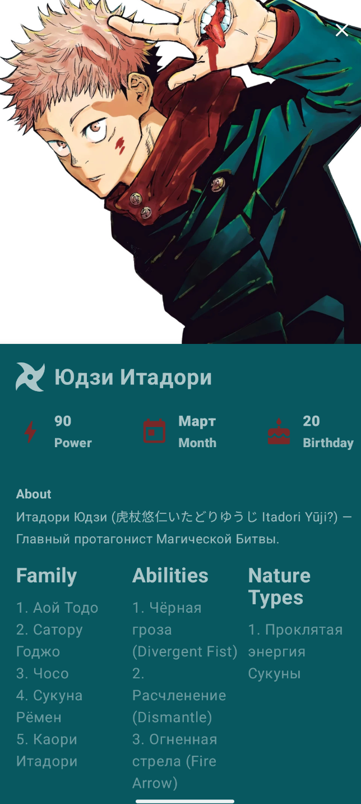
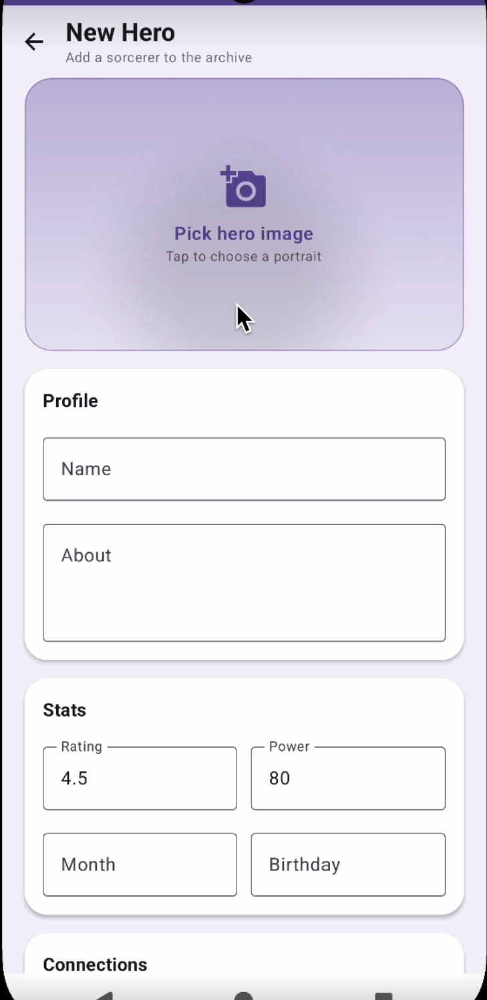

# Jujutsu Kaisen

Android-приложение с информацией о персонажах вселенной Jujutsu Kaisen.

Приложение работает с собственным REST API на Kotlin/Ktor. Поддерживает
постраничную загрузку и локальное кэширование данных, поиск персонажей,
просмотр подробной информации и создание новых персонажей с загрузкой изображения.

## Скриншоты

<p align="center">
  
  
  
</p>

Репозиторий серверной части: https://github.com/xndxdnx/ktor-server

## Возможности

- Просмотр списка персонажей с постраничной загрузкой
- Локальное кэширование данных
- Поиск персонажей
- Просмотр подробной информации о персонаже
- Создание нового персонажа
- Загрузка изображения персонажа на сервер
- Обработка состояний загрузки и сетевых ошибок
- Сохранение состояния onboarding

## Стек

- Kotlin
- Jetpack Compose
- Coroutines / Flow
- MVVM / Clean Architecture
- Hilt / Dagger
- Retrofit / OkHttp
- Paging 3
- RemoteMediator
- Room
- DataStore
- Coil
- Navigation Compose

## Архитектура

Приложение разделено на слои `data`, `domain` и `presentation`.

Для разделения источников данных, бизнес-логики и UI используются
Repository Pattern и Use Cases.

Основной поток данных:

```text
Ktor Server
     ↓
Retrofit
     ↓
RemoteMediator
     ↓
Room
     ↓
Paging 3
     ↓
Jetpack Compose